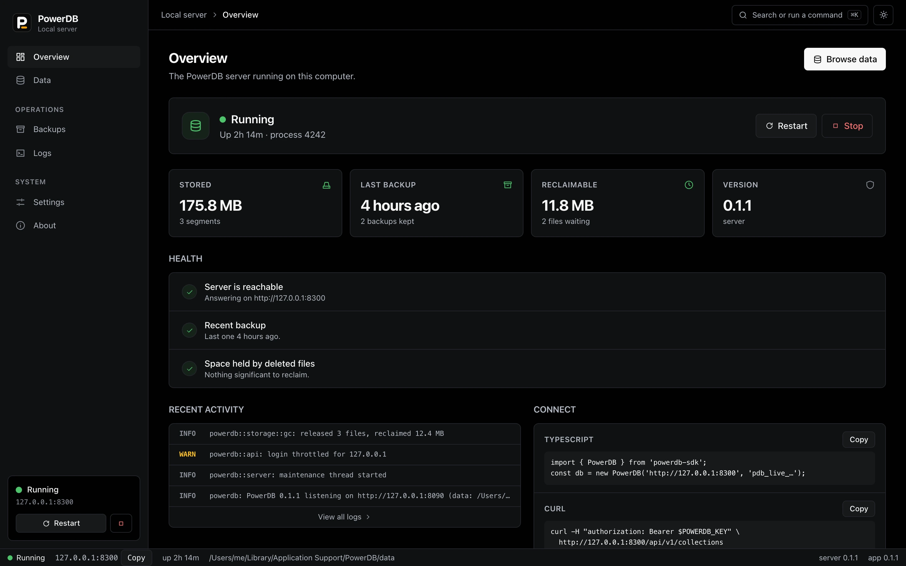
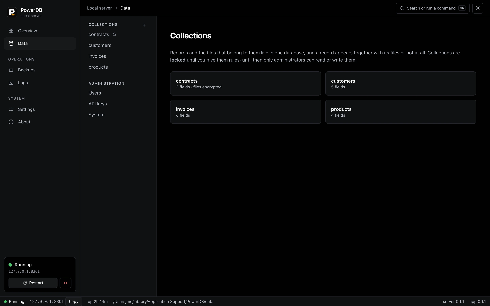
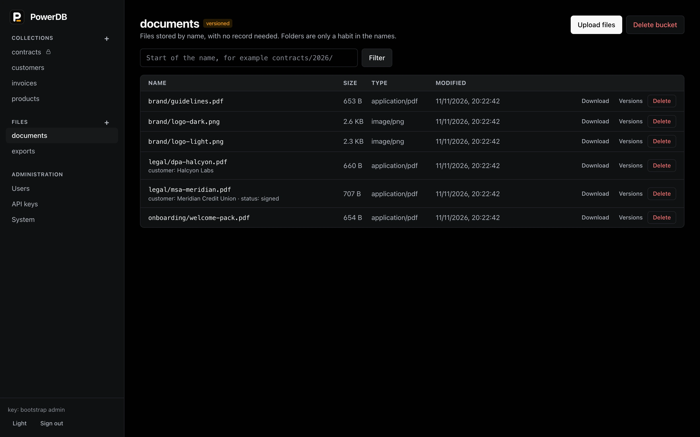

# PowerDB

PowerDB is a database for records and the files that belong to them. It saves a record and its files in one step, so you do not end up with a record pointing at a file that never arrived, or a file that belongs to nothing.

It is one program. It serves an HTTP API and a web dashboard from the same port, stores everything in a single folder, and runs on macOS, Windows and Linux. There is also a desktop app that installs and runs a local server for you. It is MIT licensed. It has no telemetry and no update checks; the only connections it makes on its own are to a sign-in provider such as Google, and only if you set one up.







## What it is for

Think of the data behind an invoicing tool, a document manager, a small SaaS product or an internal admin app: rows with attachments, a few users, rules about who sees what. You would normally combine a relational database, an object store, a signed-URL service and some glue. PowerDB is those four things in one process, aimed at the case where you would rather run one thing.

It is not a replacement for PostgreSQL. There are no joins, no SQL, and no clustering. A collection is a set of records with a fixed shape, queried by filtering and sorting.

## What you get

- **Records and files saved together.** A save either happens completely or not at all, including after a crash.
- **Files on their own.** Buckets and objects: store any file under a name (`documents/contracts/acme.pdf`) with no record behind it, optionally keeping every version. They share the same chunk store, so duplicates cost nothing and backups, checks and encryption cover them.
- **Files stored once.** Files are cut into chunks and each chunk is stored once, so a file uploaded twice, or a new version of a file that mostly repeats the old one, costs little extra space.
- **Rules.** Each collection says who may list, view, create, update and delete, in a short expression such as `@request.auth.id == owner_id`. A collection with no rules is usable by administrators only.
- **Checks on uploads.** A file is judged by its first bytes, not its name: a program renamed to `photo.png` is refused. Size limits are enforced while the upload arrives.
- **Encryption at rest** for the collections you choose, and short-lived signed links for downloads.
- **Users, API keys and OAuth.** People sign in with email and password, or with Google or GitHub when you set that up. Programs use API keys that can be limited to some collections and to read or write.
- **Backups that do not stop the server**, with restore and an integrity check.
- **A TypeScript SDK** (`powerdb-sdk`, no dependencies) and a plain HTTP API.

## Get it

**Desktop app (macOS and Windows).** Download the `.dmg` or the setup `.exe` from the [latest release](https://github.com/isagarpinninti/powerdb/releases/latest). It runs a server on your computer and gives you a window to start and stop it, browse data, read logs and take backups.

> The installers are **not signed by Apple or Microsoft** yet, so macOS and Windows will warn you the first time. [docs/INSTALL.md](docs/INSTALL.md) says how to get past the warning and how to check a download against its published checksum.

**Command line (macOS, Linux, Windows).**

```bash
powerdb init ./mydata               # creates the folder, prints an administrator key once
powerdb serve --data ./mydata       # http://127.0.0.1:8090
```

Install scripts are in `scripts/`, and a Docker image is published:

```bash
docker run -d -p 127.0.0.1:8090:8090 -v powerdb-data:/data ghcr.io/isagarpinninti/powerdb
```

To start it at boot, `powerdb service install` sets it up as a Windows Service, a launchd job or a systemd unit.

## A first look

Create a collection, add a record with a file, and read it back:

```bash
export KEY=pdb_live_...  H=http://127.0.0.1:8090/api/v1

curl -X POST -H "authorization: Bearer $KEY" -H 'content-type: application/json' $H/collections -d '{
  "name": "articles",
  "fields": [{"name": "title", "kind": "text", "required": true},
             {"name": "cover", "kind": "file", "mime": ["image/*"]}]}'

curl -X POST -H "authorization: Bearer $KEY" $H/collections/articles/records \
  -F 'data={"title":"Hello"};type=application/json' -F 'cover=@./photo.png;type=image/png'

curl -G -H "authorization: Bearer $KEY" $H/collections/articles/records \
  --data-urlencode 'filter=title ~ "Hello"' --data-urlencode 'sort=-created_at'
```

or from TypeScript:

```ts
import { PowerDB } from 'powerdb-sdk';

const db = new PowerDB('http://127.0.0.1:8090', process.env.POWERDB_KEY);
const post = await db.collection('articles').create({
  title: 'Hello',
  cover: { file: bytes, name: 'photo.png', type: 'image/png' },
});
const hello = await db.collection('articles').where`title ~ ${'Hello'}`.all();
```

Files do not need a record. Put one in a bucket and get it back:

```bash
export POWERDB_KEY=pdb_live_...
powerdb bucket create documents --versioning
powerdb object put documents/contracts/acme.pdf ./acme.pdf
powerdb object get documents/contracts/acme.pdf ./downloaded.pdf
powerdb object ls documents contracts/
```

**[docs/GUIDE.md](docs/GUIDE.md)** covers all of this properly: collections and fields, queries, files, rules, users and API keys, the SDK, backups, running it for real, and fixes for the problems people hit most. Every command in it was run against a real server.

## How it works

Records are kept in an LSM tree ([fjall](https://github.com/fjall-rs/fjall)). File bytes go to an append-only log of content-defined chunks (FastCDC, hashed with BLAKE3). A save stages the chunks first, then commits the record, the file's chunk list and the reference counts in one atomic batch. Deleted files are released in the background, and mostly-empty log segments are compacted. [docs/DESIGN.md](docs/DESIGN.md) has the details and the reasoning behind them, including the places where it chose to be simple.

The server is Rust (axum, tokio, rustls). The dashboard and the desktop app are React, and the desktop app is a [Tauri](https://tauri.app) shell around them with the server bundled inside.

## What has been measured

On one Apple-silicon laptop, over the loopback interface, with every write flushed to disk before it is acknowledged (the default):

- 3,000 records with files (181 MiB) written by 16 parallel clients: about 200 records a second, and all of them read back byte-identical.
- A 1 GiB file: about 640 MiB/s uploading and 970 MiB/s downloading, with the server's memory staying under 80 MiB, so files stream and are not held in memory.
- 5,000 records written, read and deleted by several clients while two hot backups and compaction ran: no errors, and both backups restored complete and passed the integrity check.
- The server killed with `SIGKILL` in the middle of 12 parallel writers: every write it had acknowledged was still there, with the right bytes.

These are single-machine numbers from this project's own tests, not a benchmark against anything else.

## Where it stands

PowerDB is **pre-1.0 software**. The test suite runs on every push on Linux (x64 and arm64), macOS (Apple silicon and Intel) and Windows, and the install scripts, the service installation and the desktop installers are exercised there too. It is fuzzed, and the crash behaviour is tested by killing the process.

Things it has **not** had, and that you should weigh before trusting it with data you cannot replace:

- No independent security review. [docs/SECURITY-REVIEW.md](docs/SECURITY-REVIEW.md) lists what the author checked and found, and what is open.
- No test of power loss. The crash tests kill the process; they cannot show what a disk does with unflushed writes.
- OAuth sign-in is tested against a stand-in provider, not yet against Google or GitHub themselves.
- The installers are not signed by Apple or Microsoft, so first launch shows a warning.
- There have been two on-disk formats. The one upgrade (1 to 2, which adds buckets and objects) is tested on data written by a released version, but not on large or long-lived databases.
- Buckets and objects are usable by administrators only for now; per-bucket permissions are planned, not built.

Report security problems privately, as described in [SECURITY.md](SECURITY.md).

## Try it and tell us

If you try PowerDB, the most useful thing you can do is say how it went, including when it went badly. Follow [the guide](docs/GUIDE.md) for ten minutes, or use it on something real, then tell us in [Discussions](https://github.com/isagarpinninti/powerdb/discussions):

- Did the first ten minutes work?
- Where did you get stuck?
- What did you expect to find that was not there?

A bug goes in an [issue](https://github.com/isagarpinninti/powerdb/issues/new/choose) instead. Please do not put data you cannot replace into it yet; see the list above.

## Building it

You need Rust (stable) and, to work on the dashboard or app, Node 22 or newer.

```bash
cargo build --release                     # the server: target/release/powerdb
cargo test --release                      # the server's tests, about a minute

cd dashboard && npm ci && npm test        # dashboard tests, against a real server
cd sdk && npm ci && npm test              # SDK tests
cd desktop && npm ci && npm run sidecar && npx tauri build    # the desktop app
```

[CONTRIBUTING.md](CONTRIBUTING.md) has the rest, including how to run the fuzzers. `tools/demo-data.py` fills a server with sample data, and `tools/screenshots.mjs` takes the screenshots above from it.

## Documentation

- [Using PowerDB](docs/GUIDE.md): the how-to guide
- [Installing](docs/INSTALL.md): every way to install and run it
- [Operating PowerDB](docs/OPERATIONS.md): TLS, backups, upgrades, monitoring
- [Hardening a deployment](docs/HARDENING.md): a checklist for running it where people depend on it
- [Design](docs/DESIGN.md): how it is built, and what it does not do
- [Types and tables](docs/TYPES_AND_TABLES.md): the design for typed columns, constraints and indexes (tables are built and usable; SQL is not)
- [Architecture](docs/ARCHITECTURE.md), [Roadmap](docs/ROADMAP.md), [Storage format](docs/STORAGE_FORMAT.md), [Transactions](docs/TRANSACTIONS.md), [Compatibility](docs/COMPATIBILITY.md): an audit of what exists today, and the plan toward typed tables, standalone objects and SQL
- [Security review](docs/SECURITY-REVIEW.md), [Changelog](CHANGELOG.md), [Making a release](RELEASING.md), [Third-party licences](THIRD_PARTY_NOTICES.md)

## License

MIT. See [LICENSE](LICENSE).
