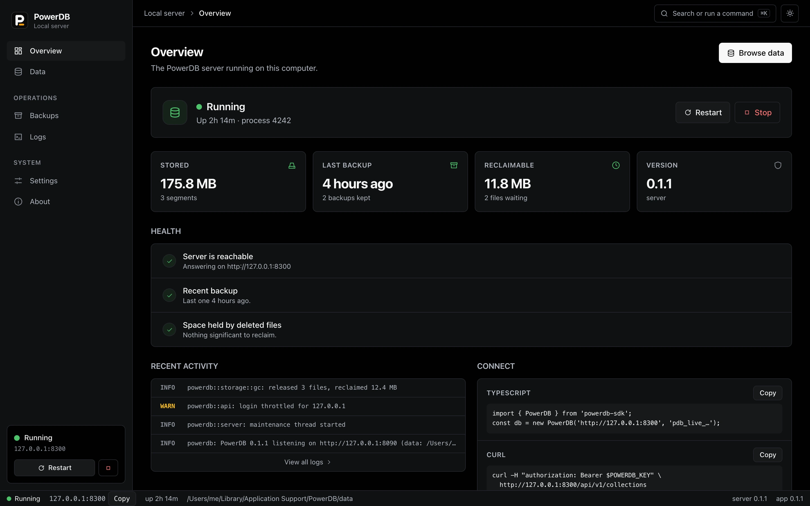
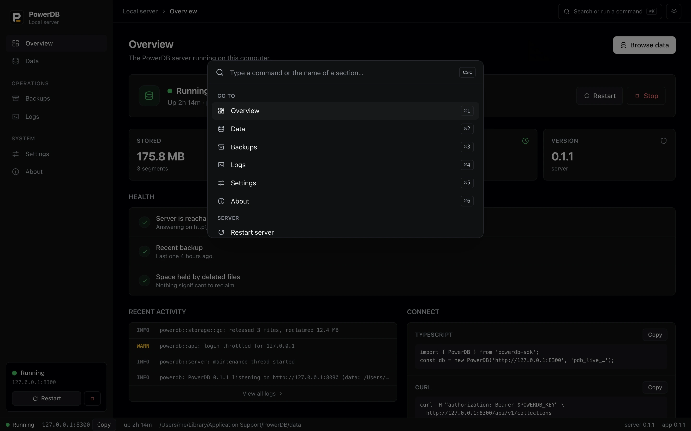
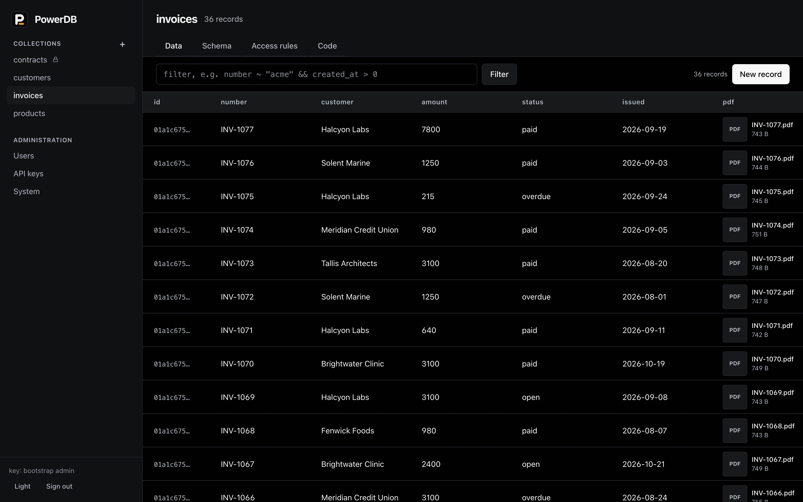
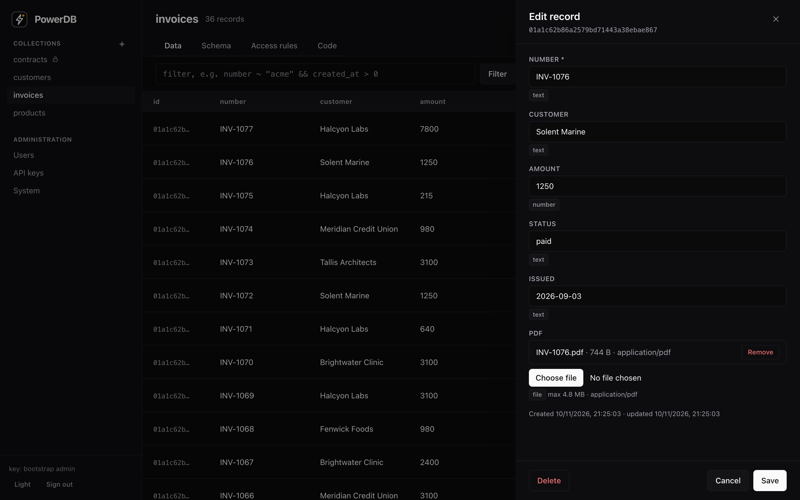
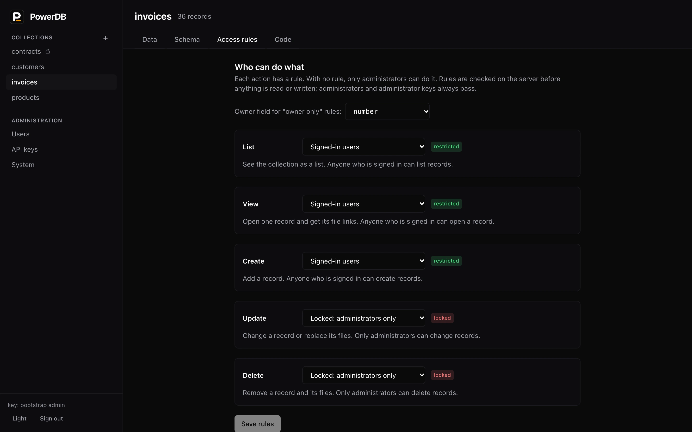
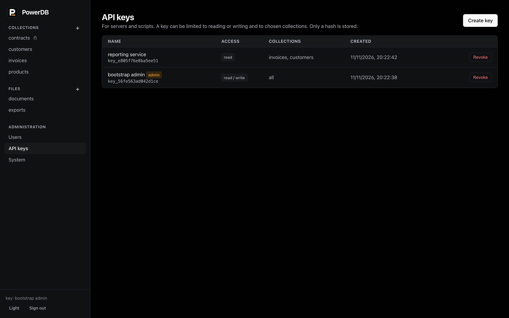
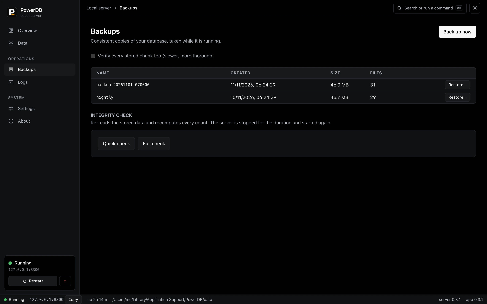

# Using PowerDB

This guide walks through PowerDB from the first start to backups and access control. Every command here was run against a real server; if something does not behave as written, that is a bug in this guide, so please report it.

- [What PowerDB stores](#what-powerdb-stores)
- [Start a server](#start-a-server)
- [The app](#the-app)
- [Your first collection](#your-first-collection)
- [Reading and querying records](#reading-and-querying-records)
- [Files](#files)
- [Who can do what](#who-can-do-what)
- [From TypeScript](#from-typescript)
- [Backups](#backups)
- [Running it for real](#running-it-for-real)
- [When something goes wrong](#when-something-goes-wrong)
- [Reference](#reference)

## What PowerDB stores

PowerDB keeps **records** and the **files attached to them** in one place, and saves a record together with its files in a single step. If a save fails halfway, you do not end up with a record that points at a missing file, or a file that belongs to nothing.

- A **collection** is a named set of records that share a shape, like a table. You define its **fields**: `text`, `number`, `bool`, `json`, `relation`, or `file`.
- A **record** is one row. It has an `id` and the two timestamps `created_at` and `updated_at` on top of your fields.
- A **file field** holds one file. Uploading the same bytes twice stores them once.
- **Rules** say who may list, view, create, update or delete in a collection. A new collection has no rules, which means *only administrators can use it*.
- An **API key** (starts with `pdb_live_`) is for programs. A **user** (email and password) is for people. Both can be limited by rules.

Everything lives in one folder, the *data folder*. The server is a single program, `powerdb`, and it serves the API and the dashboard on the same port.

## Start a server

You have three ways to run PowerDB. They all run the same server.

**The desktop app** (macOS and Windows). Install it from the [latest release](https://github.com/isagarpinninti/powerdb/releases/latest). The first time you open it, a short setup asks for a folder and a port, creates the database, and shows you an **administrator key once**. Copy it somewhere safe. The app also keeps it in your system's credential store so it can sign the dashboard in for you.

**The command line.**

```bash
powerdb init ./mydata
```

This creates the folder and prints an administrator key:

```
Administrator API key (shown once; save it):

    pdb_live_...
```

Then start it:

```bash
powerdb serve --data ./mydata
```

The server listens on `http://127.0.0.1:8090`, which means only this computer can reach it. Check it from another terminal:

```bash
powerdb status
```

**Docker.**

```bash
docker run -d -p 127.0.0.1:8090:8090 -v powerdb-data:/data ghcr.io/isagarpinninti/powerdb
docker logs <container>        # the administrator key is printed on the first start
```

For the examples below, set two variables:

```bash
export KEY=pdb_live_...                         # the administrator key
export H=http://127.0.0.1:8090/api/v1
```

## The app



The window has a sidebar with six sections and a status bar at the bottom that always shows whether the server is running, its address, and how long it has been up.

| Section | What it is for |
|---|---|
| **Overview** | Start, stop or restart the server. Shows storage used, the age of your last backup, and a short list of things that need attention. |
| **Data** | The dashboard: collections, records and files, users, API keys. |
| **Backups** | Take a backup, restore one, run an integrity check. |
| **Logs** | What the server is printing. Filter by level or text. |
| **Settings** | Port, start at sign-in, theme, and your administrator key. |
| **About** | Versions and links. |

Press **⌘K** (Ctrl+K on Windows) to open the command palette and jump to a section or run an action from the keyboard. **⌘1** to **⌘6** switch sections directly.



Closing the window leaves the server running, and a menu bar (macOS) or tray (Windows) icon stays. Choose **Quit** from that icon to stop the server and exit. If the app crashes, the server notices and shuts itself down.

## Your first collection

You can do this in the dashboard (**Data**, then the **+** next to *Collections*) or through the API. The API version:

```bash
curl -X POST -H "authorization: Bearer $KEY" -H 'content-type: application/json' $H/collections -d '{
  "name": "articles",
  "fields": [
    {"name": "title",     "kind": "text", "required": true},
    {"name": "body",      "kind": "text"},
    {"name": "views",     "kind": "number"},
    {"name": "published", "kind": "bool"},
    {"name": "cover",     "kind": "file", "max": 5000000, "mime": ["image/*"]}
  ]
}'
```

`max` is the largest file in bytes and `mime` is the list of content types the field accepts. Add a record:

```bash
curl -X POST -H "authorization: Bearer $KEY" -H 'content-type: application/json' \
  $H/collections/articles/records \
  -d '{"title": "Hello", "body": "First post.", "views": 0, "published": true}'
```

The response is the record, with its new `id`:

```json
{"id":"01a1c62b...","collection":"articles","created_at":1793600000000,"updated_at":1793600000000,"title":"Hello","body":"First post.","views":0,"published":true}
```



In the dashboard, the same records appear in a table you can filter and sort. Click a row to edit it.



## Reading and querying records

```bash
curl -H "authorization: Bearer $KEY" "$H/collections/articles/records"
```

A list answer looks like this:

```json
{"items": [ ... ], "limit": 30, "offset": 0, "has_more": false, "total": 1}
```

Four query parameters control it:

| Parameter | Meaning |
|---|---|
| `filter` | A condition. Only matching records are returned. |
| `sort` | Fields to sort by, comma separated. Put `-` in front for descending: `sort=-views,title`. Up to four. |
| `limit` | How many records per page. Default 30, at most 500. |
| `offset` | How many matches to skip, for paging. |

A filter is a small expression. These are the operators:

| Write | Means |
|---|---|
| `=` or `==`, `!=` | equal, not equal |
| `<` `<=` `>` `>=` | comparisons |
| `~`, `!~` | contains, does not contain (text) |
| `&&` or `and`, `\|\|` or `or`, `!` or `not` | combine conditions |

Text is written in single or double quotes. Remember to URL-encode the filter; `curl -G --data-urlencode` does it for you:

```bash
curl -G -H "authorization: Bearer $KEY" $H/collections/articles/records \
  --data-urlencode 'filter=published = true && views >= 10 && title ~ "Hello"' \
  --data-urlencode 'sort=-views' \
  --data-urlencode 'limit=10'
```

Get one record, change it, delete it:

```bash
curl -H "authorization: Bearer $KEY" $H/collections/articles/records/<id>

curl -X PATCH -H "authorization: Bearer $KEY" -H 'content-type: application/json' \
  $H/collections/articles/records/<id> -d '{"views": 11}'

curl -X DELETE -H "authorization: Bearer $KEY" $H/collections/articles/records/<id>
```

A `PATCH` changes only the fields you send. Setting a field to `null` clears it.

A filter text that is not valid, or that names a field the collection does not have, gets a `400` with the reason, not an empty list. Filter text is never run as code; it is parsed into a condition and checked against the collection first.

## Files

Send the record and its file together as a multipart request. The first part, named `data`, is the JSON for the record; the other parts are files, named after the file fields:

```bash
curl -X POST -H "authorization: Bearer $KEY" $H/collections/articles/records \
  -F 'data={"title":"With a cover","published":true};type=application/json' \
  -F 'cover=@./photo.png;type=image/png'
```

The `data` part must come first. The server decides whether you may create the record from it before it accepts a single byte of the file.

The server checks what it receives, not what you claim. A file whose first bytes say it is a program (a Windows `.exe`, a Linux or macOS executable, a shell script) is refused even if you call it `photo.png`. A file whose real type is not on the field's `mime` list is refused. The size limit is checked while the file arrives, so an oversized upload stops early.

The record you get back describes the file and gives a link:

```json
"cover": {"name": "photo.png", "mime": "image/png", "size": 48213, "url": "/api/v1/files/articles/01a1.../cover?token=..."}
```

That link works for one minute and only for that one file. Fetch it:

```bash
curl -o cover.png "http://127.0.0.1:8090/api/v1/files/articles/<id>/cover?token=<token>"
```

You can also send your key instead of using the token, and fetch only part of a file:

```bash
curl -H "authorization: Bearer $KEY" -H 'Range: bytes=0-1023' -o first-kb.bin \
  "http://127.0.0.1:8090/api/v1/files/articles/<id>/cover"
```

A collection created with `"encrypt": true` stores its files encrypted on disk. You read and write them exactly the same way.

To replace a file, `PATCH` with a multipart body that includes the file part. To remove one, set the field to `null`.

## Files without records

A record is not required to store a file. A **bucket** is a named container; an **object** is a file in it, reached by a name (its *key*) such as `contracts/2026/acme.pdf`. The slashes are only a habit: there are no real folders, but you can list by prefix.

Buckets and objects are for administrators for now. Use an administrator key (`powerdb init` printed one).

```bash
export POWERDB_KEY=pdb_live_...        # and POWERDB_URL=https://... if the server is not on this machine

powerdb bucket create documents
powerdb object put documents/contracts/acme.pdf ./acme.pdf
powerdb object ls documents contracts/
powerdb object get documents/contracts/acme.pdf ./downloaded.pdf
powerdb object rm documents/contracts/acme.pdf
```

`put` guesses the content type from the file name; `--type application/pdf` sets it, and `--meta customer=acme` adds a note (repeatable). `-` reads from standard input or writes to standard output. Files stream in both directions, so a very large file does not need that much memory.

The same over HTTP. The file is the request body:

```bash
curl -X POST -H "authorization: Bearer $KEY" -H 'content-type: application/json' \
  $H/buckets -d '{"name": "documents", "versioning": true}'

curl -X PUT -H "authorization: Bearer $KEY" -H 'content-type: application/pdf' \
  -H 'x-powerdb-meta-customer: acme' --data-binary @acme.pdf \
  "$H/buckets/documents/objects/contracts/acme.pdf?filename=acme.pdf"

curl -H "authorization: Bearer $KEY" -o back.pdf $H/buckets/documents/objects/contracts/acme.pdf
curl -H "authorization: Bearer $KEY" -H 'Range: bytes=0-1023' $H/buckets/documents/objects/contracts/acme.pdf
curl -I -H "authorization: Bearer $KEY" $H/buckets/documents/objects/contracts/acme.pdf   # size, type, checksum, no download
curl -H "authorization: Bearer $KEY" "$H/buckets/documents/objects?prefix=contracts/&limit=100"
```

The answer for an object carries its size, content type, a checksum (BLAKE3 of the content), the time and your metadata. Like record files, an upload is judged by its first bytes, not its name: a program uploaded as `image/png` is refused, and nothing is stored.

### Versions

A bucket created with `--versioning` (or `"versioning": true`) keeps every upload:

```bash
powerdb bucket create history --versioning
powerdb object put history/doc.txt ./v1.txt
powerdb object put history/doc.txt ./v2.txt
powerdb object versions history/doc.txt           # newest first, with their ids
powerdb object get history/doc.txt - --version <id>
powerdb object rm history/doc.txt                 # hides it; every version is kept
powerdb object restore history/doc.txt --version <id>   # makes an old version the newest again
powerdb object rm history/doc.txt --version <id>  # removes that one version for good
```

Without versioning an upload replaces the object and a delete removes it for good. Versioning can be switched on later (`powerdb bucket versioning NAME`) but not off. A bucket must be empty, delete markers included, before it can be deleted.

Identical content is stored once, however many keys and versions name it, and an object and a record's file can share one stored copy. Add `--encrypt` when creating a bucket to encrypt its data on disk.

From TypeScript: `db.buckets.create('documents')`, `db.bucket('documents').put('a/b.pdf', bytes)`, `.download(key)`, `.list({ prefix })`, `.versions(key)`, `.restore(key, version)`. The dashboard has a **Files** section with the same operations.

## Who can do what



A rule is an expression. It is evaluated for each request, and it can look at three things:

- `@request.auth.id`: the signed-in user's id, or empty when nobody is signed in.
- `@request.body.<field>`: a value in the request being made (on create and update).
- A field name on its own, such as `owner_id`: that field of the record being read or changed.

| Rule | Who it lets through |
|---|---|
| *(not set)* | Nobody except administrators. This is the default. |
| *(empty)* | Everybody, signed in or not. |
| `@request.auth.id != ""` | Anyone who is signed in. |
| `@request.auth.id == owner_id` | Only the person whose id is in the record's `owner_id`. |
| `@request.auth.id != "" && @request.body.owner_id == @request.auth.id` | Signed in, and may only create records they own. |
| `status = "published" \|\| @request.auth.id == owner_id` | Published records for everyone; drafts only for the owner. |

Set rules in the **Access rules** tab of a collection, or when you create it:

```bash
curl -X POST -H "authorization: Bearer $KEY" -H 'content-type: application/json' $H/collections -d '{
  "name": "notes",
  "rules": {
    "list":   "@request.auth.id == owner_id",
    "view":   "@request.auth.id == owner_id",
    "create": "@request.auth.id != \"\" && @request.body.owner_id == @request.auth.id",
    "update": "@request.auth.id == owner_id",
    "delete": "@request.auth.id == owner_id"
  },
  "fields": [
    {"name": "text", "kind": "text", "required": true},
    {"name": "owner_id", "kind": "text"}
  ]
}'
```

With list rules like this one, a person only sees their own records; the others are not hidden behind an error, they are simply not in the list.

### Users

```bash
# an administrator creates an account
curl -X POST -H "authorization: Bearer $KEY" -H 'content-type: application/json' $H/users \
  -d '{"email": "ann@example.com", "password": "a long passphrase"}'

# the person signs in and gets a token
curl -X POST -H 'content-type: application/json' $H/auth/login \
  -d '{"email": "ann@example.com", "password": "a long passphrase"}'
# {"token":"...","user":{"id":"usr_...","email":"ann@example.com","role":"user", ...}}

# and uses it exactly like a key
curl -H "authorization: Bearer <token>" $H/collections/notes/records
```

Passwords need at least 8 characters. Sign-in is rate limited. Accounts do not sign themselves up unless you start the server with `--open-registration`.

### API keys

Give programs a key limited to what they need:

```bash
curl -X POST -H "authorization: Bearer $KEY" -H 'content-type: application/json' $H/keys \
  -d '{"name": "reporting service", "access": "read", "collections": ["articles"]}'
```

`access` is `read`, `write` or `read-write`. `collections` limits the key to those collections; leave it out for all of them. The key is shown **once** in the answer, and only a hash is stored. Revoke it from the dashboard's **API keys** page or with `DELETE $H/keys/<id>`.

A key's limits only ever *narrow* what it can do. They never grant anything the collection's rules do not already allow. So a key that is limited to `articles` still cannot read `articles` until a rule lets it. To the rules, a key looks like a signed-in caller whose `@request.auth.id` is the key's id, so "anyone signed in" is enough:

```bash
curl -X PATCH -H "authorization: Bearer $KEY" -H 'content-type: application/json' $H/collections/articles -d '{
  "fields": [
    {"name": "title",     "kind": "text", "required": true},
    {"name": "body",      "kind": "text"},
    {"name": "views",     "kind": "number"},
    {"name": "published", "kind": "bool"},
    {"name": "cover",     "kind": "file", "max": 5000000, "mime": ["image/*"]}
  ],
  "rules": {"list": "@request.auth.id != \"\"", "view": "@request.auth.id != \"\""}
}'
```

Updating a collection **replaces its whole definition**, so send every field again, along with the rules you want. A body without `fields` is refused, so you cannot erase the schema by accident, and any rule you leave out goes back to *not set*, which means administrators only. Easier: change rules in the **Access rules** tab and let the dashboard send the whole thing.

Administrator keys, and keys made with `--admin`, skip the rules entirely. That is what makes them dangerous; keep them for yourself.



## From TypeScript

```bash
npm install powerdb-sdk
```

```ts
import { PowerDB } from 'powerdb-sdk';

const db = new PowerDB('http://127.0.0.1:8090', process.env.POWERDB_KEY);
const articles = db.collection('articles');

// create a record and its file in one call
const post = await articles.create({
  title: 'With a cover',
  published: true,
  cover: { file: coverBytes, name: 'photo.png', type: 'image/png' },   // a Blob, File or bytes also work
});

// query: values in the template are quoted for you, never pasted into the text
const minViews = 10;
const popular = await articles
  .where`published = true && views >= ${minViews}`
  .sort('-views')
  .limit(10)
  .all();

// change and delete
await articles.update(post.id, { views: 11 });
await articles.delete(post.id);

// read a file
const bytes = await db.download(post.cover);   // or db.fileUrl(post.cover) for a link
```

The template tag matters: `where\`title = ${userInput}\`` is safe with any `userInput`, including quotes and operators, because the value is encoded as a value.

Signing in a person instead of using a key:

```ts
const me = new PowerDB('http://127.0.0.1:8090');
await me.auth.login('ann@example.com', 'a long passphrase');   // keeps the token for later calls
const mine = await me.collection('notes').all();
```

Administration is under `db.admin`: `db.admin.stats()`, `db.admin.backup()`, `db.admin.backups()`, `db.admin.gc()`.

## Backups

**While the server runs** (this does not pause reads or writes):

```bash
curl -X POST -H "authorization: Bearer $KEY" -H 'content-type: application/json' \
  $H/maintenance/backups -d '{"name": "before-upgrade"}'
```

The backup is written inside the data folder, under `backups/before-upgrade`. Add `"deep": true` to also re-read and check every stored file before the backup is accepted. In the app, use **Backups** and **Back up now**.



The backup is a consistent picture of the database at one moment: every record saved before the request began is in it, and nothing half-saved is. It does **not** contain your secret key unless you ask (`"include_secret": true`). Without the secret you cannot read encrypted files from a restored copy, so keep `secret.key` somewhere safe on its own.

**Restore** into a new, empty folder:

```bash
powerdb restore --from ./mydata/backups/before-upgrade --data ./restored
cp ./mydata/secret.key ./restored/secret.key      # only if you use encrypted collections
powerdb check --data ./restored
powerdb serve --data ./restored
```

`restore` verifies every file in the backup against its checksum before it writes anything, and checks the result afterward. A backup that is damaged or has been tampered with is refused.

**With the server stopped**, `powerdb backup --to ./copy --data ./mydata` makes the same kind of copy, and copying the whole data folder also works.

A backup on the same disk protects you from mistakes, not from losing the disk. Copy backups somewhere else.

**Check the database.** `powerdb check --data ./mydata` re-reads every stored chunk and recomputes every count. It needs the server stopped. `--quick` skips re-reading the files and takes seconds.

## Running it for real

**As a service,** so it starts at boot:

```bash
sudo powerdb service install        # Linux (systemd) and macOS
powerdb service install             # Windows, from an administrator PowerShell
```

See [Installing](INSTALL.md#run-as-a-service-starts-at-boot) for the options.

**Reaching it from other computers.** By default only the computer it runs on can connect. To serve other machines, give it a TLS certificate; the key and tokens travel in request headers and must not cross a network in the clear:

```bash
powerdb serve --data ./mydata --addr 0.0.0.0:8443 --tls-cert cert.pem --tls-key key.pem
```

Or put a proxy such as Caddy or nginx in front and start the server with `--trust-proxy`. [Operating PowerDB](OPERATIONS.md) has the details, a backup routine, and a checklist.

**Settings** live in `powerdb.toml` inside the data folder. Command-line flags override environment variables, which override the file. An unknown key in the file is an error, so a typo cannot silently do nothing.

## When something goes wrong

**The app window is empty or stuck on "Starting PowerDB…".** Open the file `frontend.log` in the app's settings folder (`~/Library/Application Support/dev.powerdb.desktop` on macOS, `%APPDATA%\dev.powerdb.desktop` on Windows). It records what the interface did. If it ends at `snapshot: asking`, macOS may be waiting for you to answer a Keychain dialog.

**macOS asks for your Keychain password.** The app is not yet signed with a developer certificate, so macOS treats each new build as a new app. Choose **Always Allow**; you will be asked again after an update.

**"is in use by another PowerDB process".** A data folder can be opened by one server at a time. Stop the other one, or choose another folder. After a crash the lock is released by the system, so a restart works.

**"port 8090 is already answering" or "not available".** Something else is using the port. Choose another in the app's **Settings**, or pass `--addr 127.0.0.1:8091`.

**I lost the administrator key.** Make a new one with the server stopped: `powerdb create-key --name recovery --admin --data ./mydata`. It prints the key once.

**`powerdb check` says the metadata store is damaged.** A storage file failed its checksum. Restore from a backup. The message names the folder.

**Windows says "Windows protected your PC".** The installer is not code-signed. Choose **More info**, then **Run anyway**. You can compare the file's SHA-256 with `SHA256SUMS` on the release page first.

**A request returns 401 or 403.** `401` means no valid sign-in was sent; `403` means you are signed in but a rule (or the key's scope) does not allow it. A collection with no rules is open to administrators only. One exception to know about: a *list* rule that looks at the record (such as `@request.auth.id == owner_id`) does not fail, it filters, so a caller who owns nothing gets an empty list, not an error.

## Reference

### Command line

| Command | What it does |
|---|---|
| `powerdb init [DIR]` | Create a data folder and print an administrator key. |
| `powerdb serve` | Run the server. `--data`, `--addr`, `--tls-cert`, `--tls-key`, `--open-registration`, `--cors-origin`, `--trust-proxy`, `--durability`, `--max-upload-gib`. |
| `powerdb status` | Ask a running server whether it is healthy. |
| `powerdb check` | Verify a stopped database. `--quick` for structure only. |
| `powerdb backup --to DIR` | Copy a stopped database. |
| `powerdb restore --from DIR --data DIR` | Verify a backup and restore it into an empty folder. |
| `powerdb create-key --name N` | Make an API key without starting the server. `--access read\|write\|read-write` (default read), `--collection`, `--admin` (full access, skips rules). |
| `powerdb bucket create\|ls\|rm\|versioning` | Buckets on a running server. `--url` and `--key` (or `POWERDB_URL`, `POWERDB_KEY`). |
| `powerdb object put\|get\|ls\|rm\|versions\|restore` | Files in buckets on a running server. `put BUCKET/KEY FILE`, `get BUCKET/KEY [FILE]`, `--version`, `--meta`, `--type`. |
| `powerdb service ...` | `install`, `uninstall`, `start`, `stop`, `status` for the operating system's service manager. |
| `powerdb bench` | Measure the storage engine on this machine. |

### Durability

`--durability commit` (the default) makes sure each write is on disk before it is acknowledged: safe if the power fails, around 300 to 1,000 writes a second on an SSD. `interval` flushes in the background every 100 ms: much faster, and a power cut can lose the last fraction of a second. `never` is for throwaway data.

### API

All paths are under `/api/v1`. Send `authorization: Bearer <key or token>`.

| Method and path | Purpose |
|---|---|
| `GET /healthz` | Is the server up (no sign-in needed). |
| `POST /auth/login`, `/auth/refresh`, `/auth/password`; `GET /auth/me` | People signing in. |
| `GET /auth/oauth/providers`, `/auth/oauth/{provider}/start` | Sign in with Google, GitHub or another provider, when configured. |
| `GET, POST /collections` | List or create collections (administrators). |
| `GET, PATCH, DELETE /collections/{name}` | Read a collection, replace its definition (send `fields` and `rules`), or remove it. |
| `GET, POST /collections/{name}/records` | List with `filter`, `sort`, `limit`, `offset`; create (JSON or multipart). |
| `GET, PATCH, DELETE /collections/{name}/records/{id}` | One record. |
| `GET /files/{collection}/{id}/{field}` | A file; supports `Range` and a `?token=` link. |
| `GET, POST /buckets`; `GET, PATCH, DELETE /buckets/{name}` | Buckets (administrators). `PATCH` with `{"versioning": true}` turns versioning on. |
| `PUT, GET, HEAD, DELETE /buckets/{name}/objects/{key}` | An object. `PUT` takes the file as the request body (`?filename=`, `X-PowerDB-Meta-*` headers); `GET` supports `Range` and `?version=`; `DELETE` takes `?version=`. |
| `GET /buckets/{name}/objects` | List by `prefix`, with `after` (the previous page's `next`) and `limit`. |
| `GET /buckets/{name}/versions?key=` , `POST /buckets/{name}/restore` | Versions of a key, newest first; restore one with `{"key": ..., "version": ...}`. |
| `GET, POST /keys`, `DELETE /keys/{id}` | API keys. |
| `GET, POST /users`, `DELETE /users/{id}` | Accounts. |
| `GET, POST /maintenance/backups` | List or take backups. |
| `POST /maintenance/gc` | Reclaim space from deleted files now. |
| `GET /stats`, `GET /metrics` | Storage numbers; Prometheus text. |
